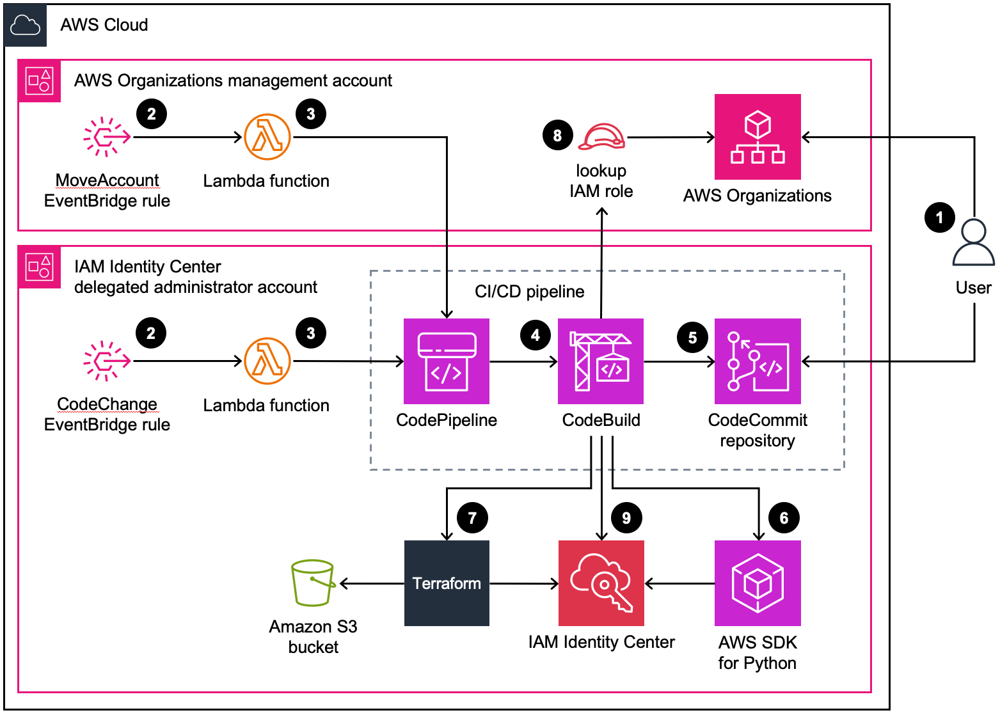

# AWS IAM Identity Center Pipeline

AWS IAM Identity Center (successor to AWS Single Sign-On) helps you securely create or connect your workforce identities and manage their access centrally across AWS accounts and applications. IAM Identity Center is the recommended approach for workforce authentication and authorization on AWS for organizations of any size and type. Companies can bring their identities from their Microsoft Active Directory to assign them to AWS accounts with specific permissions. With the AWS Identity Center, you get a unified administration experience to define, customize, and assign fine-grained access.

This pattern helps you to manage AWS IAM Identity Center permission in your multi-account environment as a code. With this pattern, you will be able to achieve the following defined as code:
* Create, delete and update permission sets 
* Create, update or delete assignments from your permission set with your target (AWS accounts or AWS Organization Units) with your federated users from your AWS IAM Identity Center Identity Store (e.g. Microsoft Active Directory)

To manage your AWS IAM Identity Center permissions and assignments as code, this solution will deploy a pipeline with AWS services (AWS CodeCommit, AWS CodeBuild and AWS CodePipeline). The pipeline will be triggered every time someone commits changes to specific files in the repository or any time an AWS account is moved from its AWS Organizational Unit. The triggers are implemented using AWS EventBridge rules based on patterns and a AWS Lambda function

The code in this repository helps you set up the following target architecture.

For prerequisites and instructions for using this AWS Prescriptive Guidance pattern, see [Manage AWS IAM Identity Center permission sets as code by using AWS CodePipeline](https://docs.aws.amazon.com/prescriptive-guidance/latest/patterns/manage-aws-iam-identity-center-permission-sets-as-code-by-using-aws-codepipeline.html).

## Sample permission sets

The files in `templates/permissionsets/` are examples of job-function personas (administrator, product owner, database, network, operations, production and security). They are intentionally broad, mirror AWS managed job-function policies where one exists, and must be tailored (resources, conditions, regions, assignment targets) before being used in production. Least privilege for these personas comes from the assignment scope (`templates/assignments/`) and from your SCPs as much as from the policy itself.

Security scan findings on the samples and how they were handled:

* `AWSAdministrator` and `ProductOwner` attach `AdministratorAccess` on purpose: one is the break-glass/platform administrator (equivalent to the `AWSAdministratorAccess` permission set of AWS Control Tower), the other demonstrates the "account owner with guardrails" pattern, where an explicit `Deny` protects the security baseline (CloudTrail, AWS Config, GuardDuty, Security Hub, IAM principals, Identity Center, Organizations). Assign them only to the accounts and groups that need them.
* `DatabaseAdministrator` and `NetworkAdministrator` are copies of the AWS managed job-function policies of the same name, kept inline so they can be tailored. `ec2:DeleteVolume` (an EBS action, not a network one) was removed from `NetworkAdministrator`.
* `OperationEngineer` keeps service-level wildcards for the services an operations team runs; `organizations:*` was replaced by read-only `organizations:Describe*`/`organizations:List*`, because Organizations write actions only work in the management or a delegated administrator account.
* `ProductionAccess` keeps the EC2/ECS/SSM operational actions on `Resource: "*"` (the ARNs or tags that would scope them are customer specific), `support:*` (AWS Support has no resource-level permissions and operators open cases during incidents) and `wellarchitected:*` (the tool only stores reviews). `iam:PassRole` was moved to its own statement with the condition `iam:PassedToService` limited to EC2, ECS, Systems Manager and Auto Scaling, which closes the privilege escalation of an unscoped PassRole. Note that `ssm:*Document*` includes `ssm:ModifyDocumentPermission` (sharing documents with other accounts); replace it by the document actions you use.
* `SecurityEngineer` is reported for `iam:*`, `kms:*`, `organizations:*` and other wildcards, but it carries the permissions boundary `job-function/SystemAdministrator`, which IAM Identity Center applies to the role provisioned in every account. The effective permissions are the intersection with the boundary: `iam:*` becomes read-only, `organizations:*`, `sso:*`, `identitystore:*` and `secretsmanager:*` are effectively denied and `kms:*` loses key policy changes, decryption and deletion. Keep the boundary if you keep the wildcards.

The 12-digit numbers in `templates/assignments/` are placeholders (the same example account ID used by the AWS documentation), not secrets: a target in the form `account_name:account_id` is how the pipeline identifies the account that receives an assignment, so they belong in version control. Do not add non-JSON files (such as a README) to `templates/permissionsets/` or `templates/assignments/`, because the pipeline loads every file in those folders as JSON.